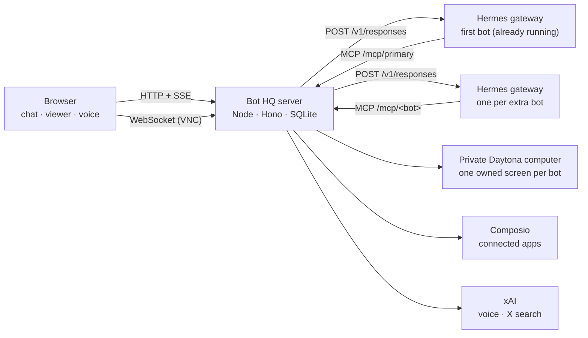

<p align="center">
  
</p>

<p align="center">
  A team of AI agents you chat with, each with its own screen on one cloud computer.<br>
  <a href="https://github.com/NousResearch/hermes-agent">Hermes Agent</a> runs the bots, a private Daytona computer gives them screens, <a href="https://composio.dev">Composio</a> connects their apps, and <a href="https://x.ai">xAI</a> gives them a voice and research on X.
</p>

<p align="center">
  <a href="#what-you-get">What you get</a> ·
  <a href="#how-it-fits-together">How it works</a> ·
  <a href="#install-on-the-computer">Install</a> ·
  <a href="#run-it-locally">Run locally</a> ·
  <a href="docs/ARCHITECTURE.md">Architecture</a> ·
  <a href="#status-and-limits">Limits</a>
</p>

<p align="center">
  
  
  
</p>

<p align="center">
  <picture>
    <source media="(prefers-color-scheme: dark)" srcset="assets/screenshots/chat-dark.png">
    
  </picture>
</p>

---

Give a bot a job, connect the apps it needs, and follow its work in chat. Each bot has a name, a look, its own memory, and a screen you can watch or take over. Bots can message each other, run recurring tasks, and talk with you over voice.

The interface is modeled on Grok Bot. Underneath, every bot is a Hermes agent, so it can run on the model subscriptions you already pay for (Claude, ChatGPT, Grok and others) or on API keys.

## What you get

| | |
|---|---|
| **Chat that shows the work** | While a bot works you see what it is doing right now, how long it has been at it, and each step it took. Finished turns fold into a "Worked for 2m 10s · 7 steps" chip you can open. |
| **A screen per bot** | Every bot has its own desktop on the shared computer. Watch it live in the side panel, open it full size, or take control with your own mouse and keyboard. |
| **Your existing Hermes agent, kept as it is** | The first bot is the Hermes agent already running on the computer. Its messaging channels, skills and memory keep working; the app only calls its API. |
| **Connected apps with approvals** | Bots ask for the app they need and you connect it through Composio. Actions that write (send, post, delete) wait for your OK on a card in the chat. |
| **Model and subscription per bot** | Pick the provider and model in the bot's Engine panel, or sign in to a subscription on the bot's own screen. |
| **Voice** | Talk to a bot with xAI's realtime voice modes. Real work is handed to the same bot, with the same memory and tools. |
| **Research on X** | Every bot has an `x_search` tool, backed by xAI. |
| **Routines, tasks and a Library** | Recurring jobs on a schedule, a task list per bot, and a place where bots save the files they make. |

<table>
  <tr>
    <td width="50%"></td>
    <td width="50%"></td>
  </tr>
  <tr>
    <td align="center"><sub>Watching a bot's screen live</sub></td>
    <td align="center"><sub>Each screen is dressed as that bot's own computer</sub></td>
  </tr>
</table>

<sub>The chat screenshot at the top uses the sample data built into the dev server (add <code>?fixtures</code> to the URL). The two above are from a running install.</sub>

## How it fits together



- **One computer, one owned screen per bot.** The app uses an existing private Daytona computer. Four lazy screens100–103 include the app's primary screen100; the original desktop stays separate.
- **The first bot is the Hermes agent that already runs on that computer.** The app talks to its gateway and never restarts it or rewrites its settings.
- **Every other bot gets its own Hermes home and gateway**, started by the app. Each has its own model, sign-in, memory, browser profile and files.
- **The app's tools reach Hermes over MCP.** The server exposes `/mcp/<bot>`. Each agent gets connected apps, `x_search`, tasks, routines, the Library, and messages to other bots.
- **Screens are dressed to look like the bot's own computer**: a light desktop with a dock, and a home screen with the bot's name and apps as Chrome's new tab page.

More detail is in the [architecture guide](docs/ARCHITECTURE.md).

### How this relates to Hermes Bot Mode

Hermes Desktop has its own Bot Mode. Bot HQ uses the same Hermes engine but does **not** use Bot Mode: it has its own bot layer on top of the gateway's HTTP API.

| | Bot HQ | Hermes Bot Mode |
|---|---|---|
| A bot is | A separate Hermes home (the first bot is the default profile) | A Hermes profile |
| Gateways | One per extra bot | One, serving every profile |
| Transport | HTTP, `/v1/responses` | JSON-RPC over WebSocket |
| Routines | The app's own scheduler | Hermes cron jobs |
| Bot to bot | The app's `send_to_bot` tool | Hermes' `message_agent` tool |

So bots made here do not show up in Hermes Desktop's Bots tab, and bots made there do not show up here.

## Existing deployments

This change intentionally moves the app to a dedicated `HQ_ROOT` and private Daytona
configuration. Upgrading requires configuration changes; copying the new `.env.example`
over a working deployment is not a migration. Nothing automatically copies an old
database, Hermes home, credentials or profiles. There is no fallback to Orgo or to a
user's global `~/.hermes`.

| Setting | Previous default | New default / requirement |
|---|---|---|
| `HQ_ROOT` | Not used | Exclusive absolute root, default `~/bot-template-private` |
| `DB_PATH` | Repository `data/grokbot.db` | `HQ_ROOT/data/hq.db`; explicit absolute `DB_PATH` can retain an existing database |
| `HERMES_HOME_PRIMARY` | `~/.hermes` | `HQ_ROOT/hermes-primary`; must resolve inside `HQ_ROOT` |
| `ENGINES_DIR` | Repository `data/engines` | `HQ_ROOT/engines`; must resolve inside `HQ_ROOT` |

When the previous default `data/grokbot.db` exists and `DB_PATH` is unset, startup stops
with an actionable error before opening a new database. Set `DB_PATH` explicitly to
the existing absolute path to retain it, or migrate it before starting. Keep an existing
explicit `DB_PATH` if your old database used another location: the app cannot discover
arbitrary old paths. If both old and new files exist, select one explicitly. Detection
uses file metadata and does not open the legacy database.

Before upgrading an installation you own:

1. Record its effective database path, primary Hermes home, managed homes, profiles,
   Library and app configuration. Stop only that app and its own managed gateways;
   do not stop a shared desktop, runner or unrelated primary gateway.
2. Back up each complete affected unit with ownership, permissions and timestamps.
   Preserve the SQLite unit including any `-wal`/`-shm` files; copying only the main file
   while a writer is running is insufficient. Keep the original units intact.
3. Choose an exclusive `HQ_ROOT`. Keep the backed-up existing database path as explicit
   `DB_PATH`, or copy the complete quiescent unit into the dedicated data directory and
   set `DB_PATH` to the migrated file for the first start.
4. Only for Hermes homes belonging to this installation, copy each complete home into
   the dedicated primary/managed directories with metadata preserved. Set explicit
   `HERMES_HOME_PRIMARY` and `ENGINES_DIR` inside `HQ_ROOT`; symlinks escaping it are
   rejected even when the destination does not exist yet. Do not borrow an unrelated
   global Hermes configuration or credentials. If the old primary is shared, provision
   a separate dedicated primary and authenticate it instead of relocating it.
5. Preserve the whole copied configuration before updating paths and the MCP endpoint,
   verify that only intended settings changed, and supply private Daytona configuration
   through backend files. Start only dedicated services; verify existing users, bots,
   sessions, Library and model state before accepting the upgrade.

To roll back, stop only the upgraded app and its own gateways, restore the complete
backed-up configuration/data units with metadata, and use the previous application
version and its environment. Do not delete originals to make the new layout appear
empty or successful. These are operator instructions; the private test deployment
never reads or copies another installation's credentials.

## Install on the existing private computer

The supported test deployment runs the HQ inside an existing Daytona sandbox with `HQ_LOCAL=1`.
Set `HQ_ROOT=/home/daytona/bot-template-private` and upload the built artifact and a private
`config/daytona.env` using the existing toolbox files API. It contains `DAYTONA_API_URL`,
`DAYTONA_API_KEY` and `DAYTONA_SANDBOX_ID`. Use mode 0600 in a 0700 directory.
The server also accepts `DAYTONA_API_KEY_FILE`; the key stays in the backend.
No Orgo fallback or sandbox lifecycle actions are available.

Build on the development box (`npm ci`, `npm rebuild better-sqlite3 esbuild`, `npm run build`).
Package `server/dist`, `server/box`, `web/dist`, `web/src/avatar/shapes.gen.ts`, `scripts` and production dependencies, along
with a compatible private Node runtime. For first install, upload the installer to a new
operator-owned temporary path and run `HQ_ROOT=... bash <installer-path> --prepare` before
uploading files into `HQ_ROOT`; this creates the ownership marker and private directories.
An existing unmarked root is refused. Upload the runtime/artifact and private config only
after preparation, then install using `scripts/install-on-computer.sh`;
it writes under `HQ_ROOT`, retains the complete old app under `incoming/app-before-*`,
and does not restart services. Stop only this installation before replacing its files. See
[private deployment and verification](docs/private-computer.md) for the tested snapshot,
Hermes provenance, optional dependencies, private access and rollback.

`python3 app/scripts/private-service.py start app` starts the app with dedicated HOME/XDG.
The corresponding `stop app` verifies PID, kernel start time and command before stopping it.
SQLite, profiles and Library live outside `app/`; keep them across upgrades.
Hermes primary and managed homes are dedicated to this installation; global credentials
are never imported. Configure a model in that dedicated home before a real conversation.
Creating a bot does not eagerly start every managed gateway.

The app has four lazy leases, mapped centrally to displays 100–103, with private loopback VNC,
WebSocket and CDP ports. The original desktop and displays 0/99 are outside the registry.
Browser profiles, GTK settings and desktop helpers belong to this root only.
Downloads still require the bot owner's session and resolve real paths before serving files.

## Development

Copy `.env.example`, configure the existing private computer and a session secret, then run
`npm run dev`. Computer viewers require deployment inside that guest (`HQ_LOCAL=1`).
Do not run `tests/e2e.mjs` against unapproved external providers.

```bash
npm run test:private-computer
npm run typecheck
npm run build
```

xAI and Composio are optional. Their features return an actionable configuration error when
absent; computer login, screens and Library remain testable using the owner sign-in flow.
`HQ_ROOT=... bash scripts/sign-in-link.sh operator@example.com` stores a one-use sign-in
URL in private `config/sign-in.json` without printing its credentials.

## Models and subscriptions

Open a bot's details panel, **Engine**. Pick a provider and model there. **Sign in to a subscription** opens a terminal on the bot's screen running Hermes' own sign-in for that provider (for example Claude Pro/Max), so you finish it in the viewer and the bot uses that subscription from then on. Check your provider's terms before running an agent on a consumer subscription.

The legacy `tests/e2e.mjs` calls real providers; do not run it without separate provider authorization.
The process/session fixtures in `test:private-computer` require Linux with `/proc` by design.
Run that suite on the Linux box/guest; macOS can review the snapshot and run typecheck/build,
but cannot attest these kernel identities. No unverified process-group kill fallback is used.

```text
server/src/         API, Hermes adapter (agent/loop.ts), engines (engine.ts), MCP endpoint (mcp.ts), screens (computer.ts)
server/box/         what runs on the computer to dress a screen (desktop, dock, home screen, Chrome)
web/src/            chat, bot settings, app connections, computer viewer, voice
scripts/            pack, install, Hermes config helper, sign-in link
tests/              Playwright end-to-end test
docs/               architecture; the Orgo and xAI/Composio guides predate the Hermes engine
```

## Status and limits

- Experimental, no security audit. Bots share one computer and can reach each other's files there.
- Approval cards cover Composio write actions. What a bot does through its browser or shell is not gated, and Hermes' own "risky command" prompts are not shown in the app yet.
- Four bots at most, in the app-owned lease registry.
- The app still calls itself "Grokbot" in places (page title, package names, the database file).
- The screen look is an original implementation inspired by OrgoAI/bops; no code or assets from that repository are used.

## License and credits

Project code is available under the [MIT license](LICENSE). The bot artwork and some icons come from Grok Bot's design and remain the property of their owners, as do third-party app logos; the MIT license does not cover them. See [third-party notices](THIRD_PARTY_NOTICES.md).

Continued from [grokbot-clone](https://github.com/nickvasilescu/grokbot-clone). Built with [Hermes Agent](https://github.com/NousResearch/hermes-agent), [Orgo](https://orgo.ai), [Composio](https://composio.dev), and [xAI](https://x.ai). This is an independent project, unaffiliated with xAI, Cursor/Anysphere or Nous Research.
